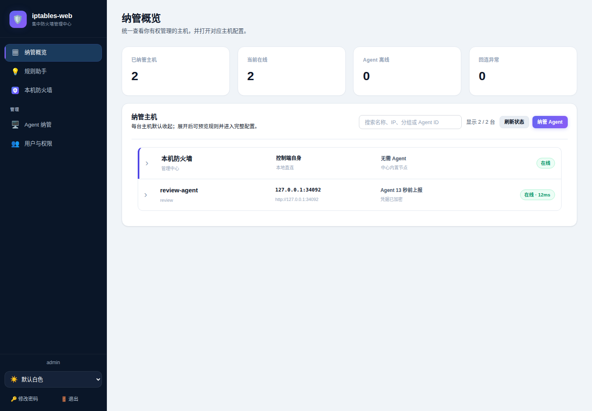
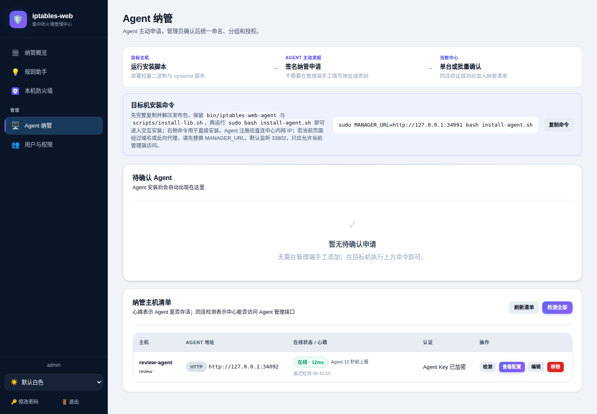
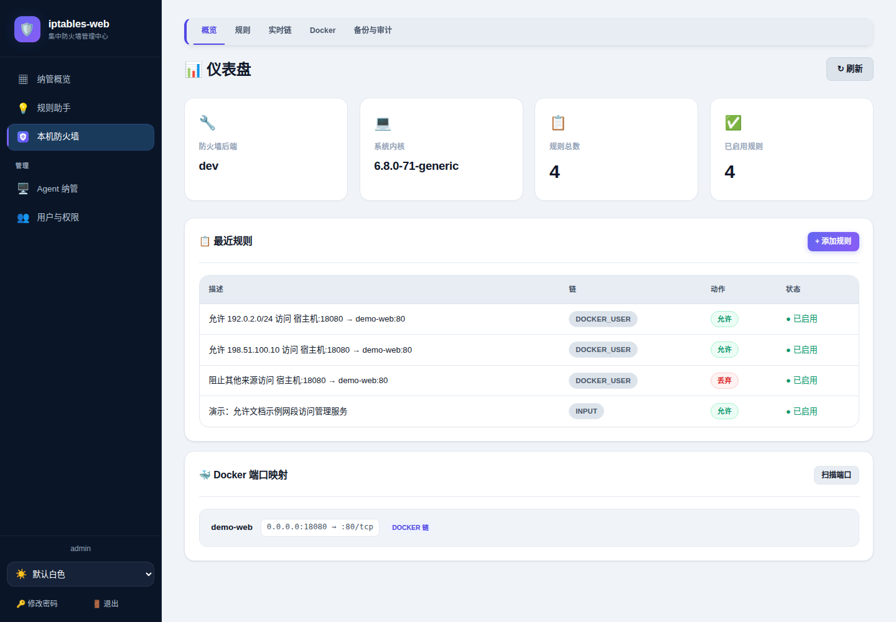
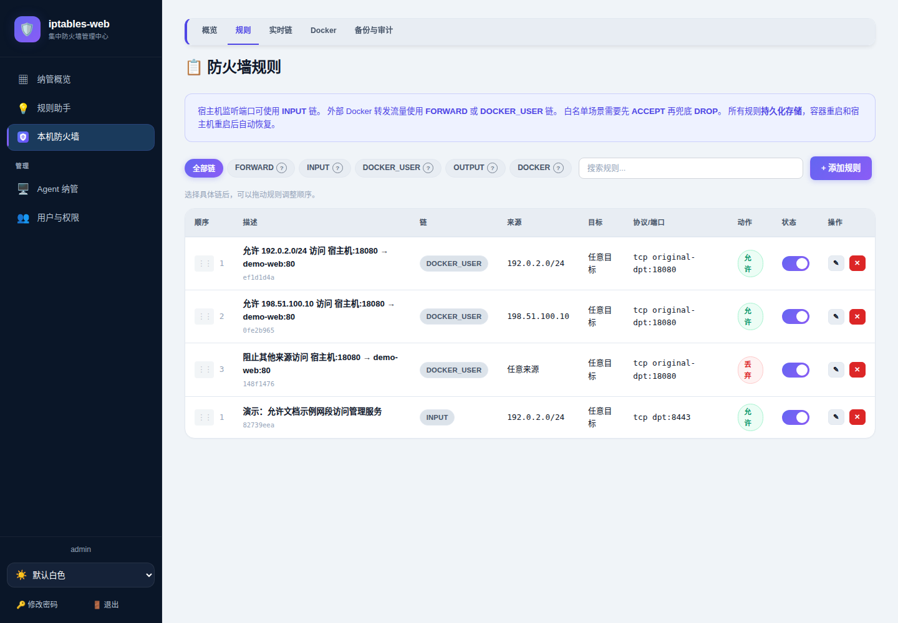
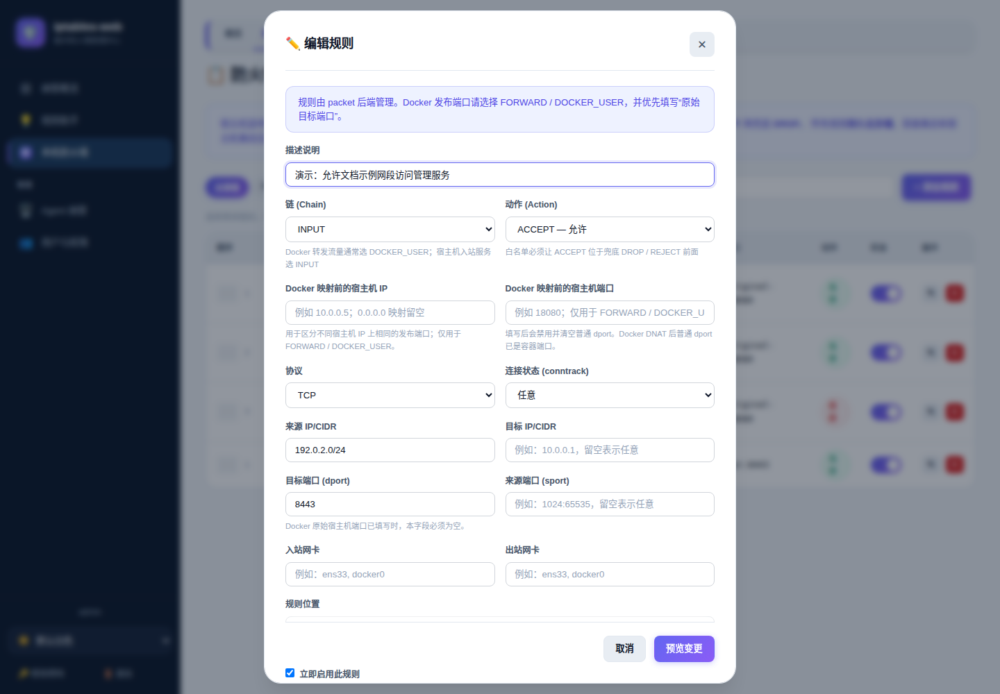
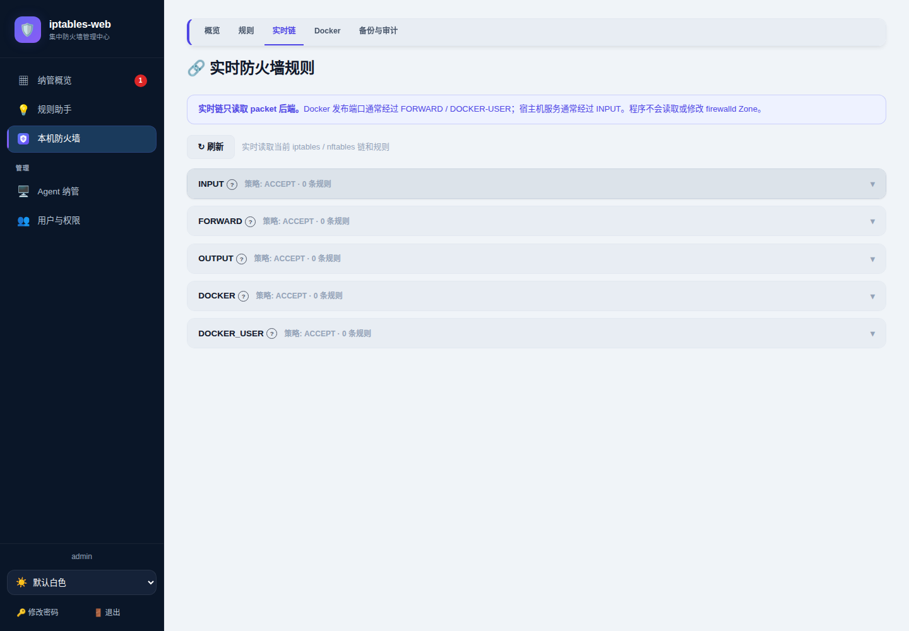
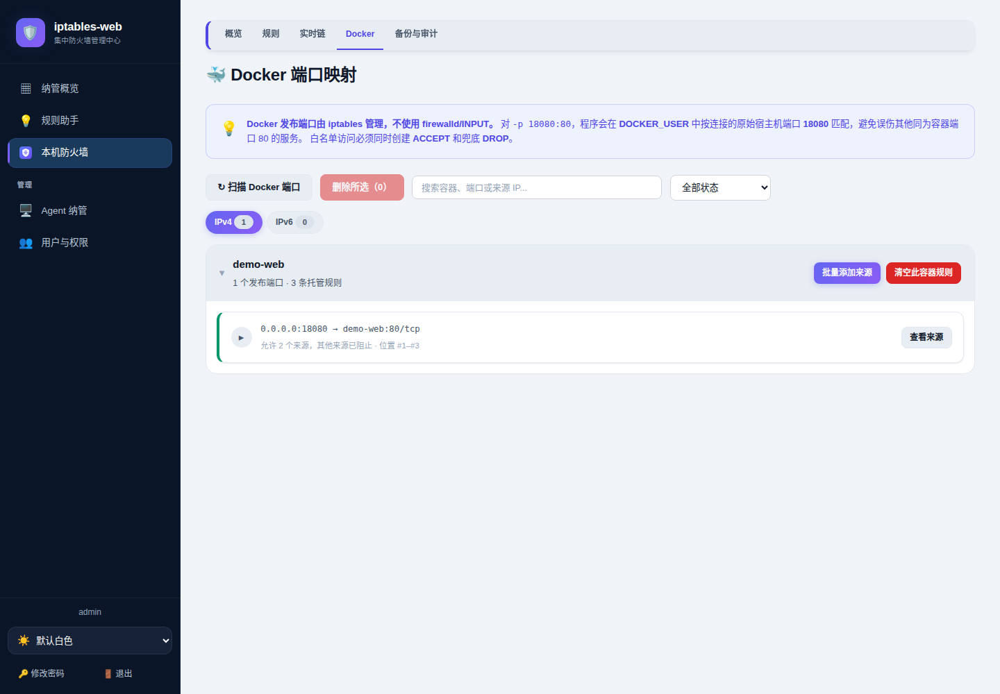
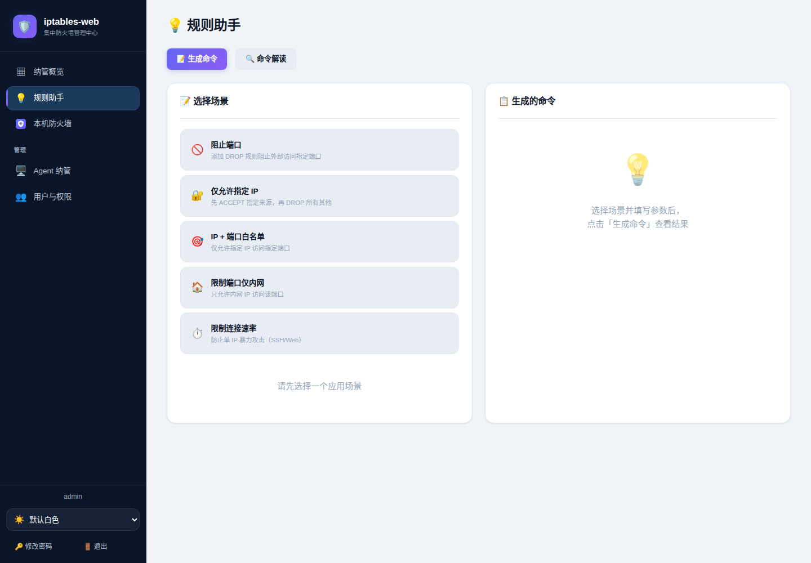
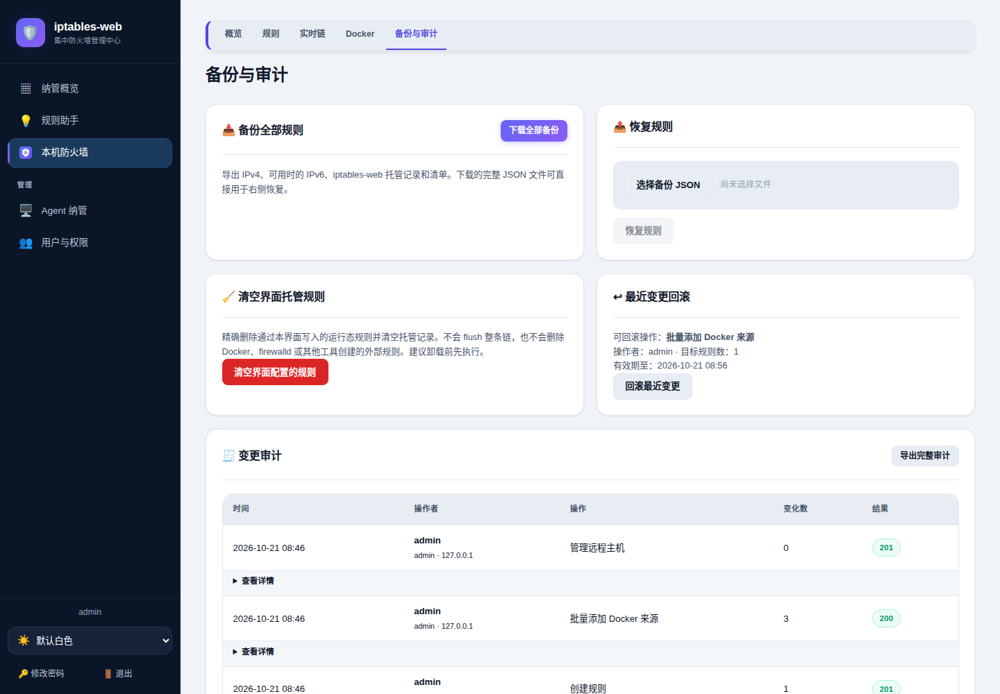
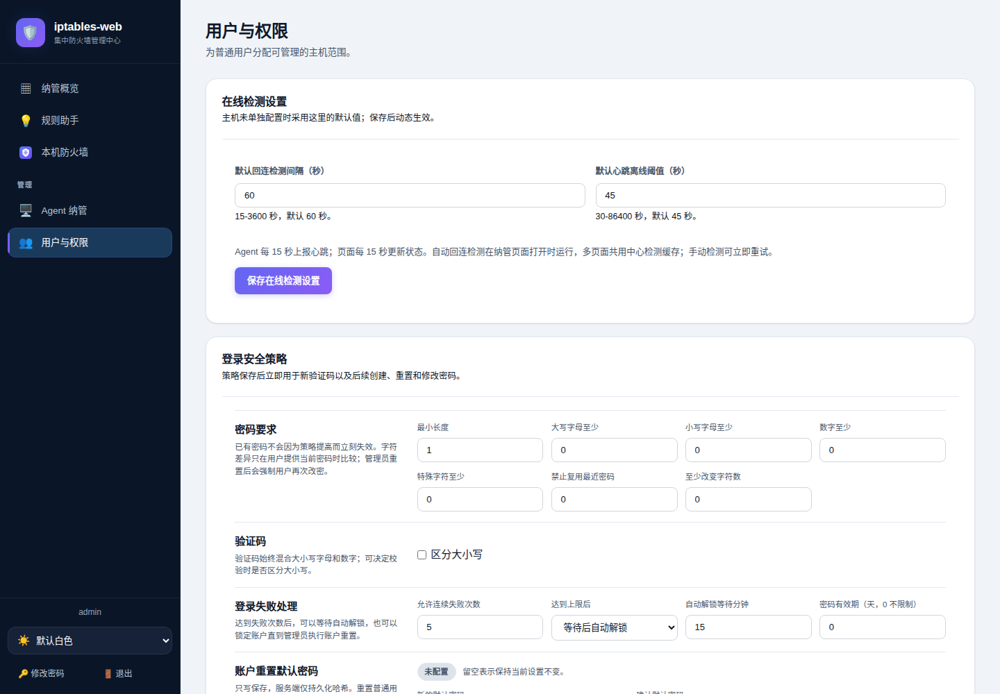

# iptables-web

面向私有云、边缘节点与自托管基础设施的轻量级 Linux 防火墙控制平面。

iptables-web 将分散在多台 Linux 主机上的 packet 防火墙与 Docker 发布端口，收敛为一套可视、可审计、可回滚的治理闭环。中心端提供统一控制平面、身份认证和按主机授权；目标机仅运行无界面的轻量 Agent。系统通过 `iptables` 或 `iptables-nft` 兼容层管理带所有权标记的规则，不接管 firewalld，不覆盖其他工具的配置，也不启用原生 nftables 写入后端。

[功能截图](#功能截图) · [快速安装](#安装部署) · [使用文档](docs/index.md) · [更新计划](docs/roadmap.md) · [问题反馈](https://github.com/anhaot/iptables-web/issues)

> [!IMPORTANT]
> 首次启动会创建 `admin/admin123`。首次登录必须修改密码，完成前服务端会拒绝规则、用户、备份等其他管理请求。当前 Go 进程直接提供 HTTP：Agent 可在受 ACL 保护的可信内网按 IP 直连，浏览器生产入口建议配置 HTTPS；跨不可信网络必须使用 VPN、零信任隧道或逐台 HTTPS。

## 项目介绍

防火墙管理真正困难的部分，从来不只是“写出一条命令”：规则必须落在正确的链上，Docker 流量必须区分 DNAT 前后的端口，白名单必须先于兜底拒绝生效，每次修改还应当能够解释、追踪和恢复。iptables-web 围绕这些工程问题设计，把一次高风险的命令行操作变成一条完整的控制链路：预览、校验、持久化、内核写入、运行态核验、审计与限时回滚。

它适合希望保留 Linux 原生防火墙能力，同时又需要统一治理体验的团队：无需数据库、无需 Node.js 运行时、无需在目标机部署完整 Web 系统。单机可以独立运行，规模扩大后可平滑纳入中心端；主机和动态访问密钥实时生效，不因扩容要求重启控制平面。

核心场景包括：

- 管理宿主机 `INPUT`、`OUTPUT` 和转发相关 packet 规则；
- 查看 Docker 确认发布的 IPv4/IPv6 端口映射；
- 为 Docker IPv4 发布端口设置允许来源和兜底阻止策略；
- 保存前预览字段变化，降低规则范围和顺序误判；
- 记录经授权的操作主体与变更详情，导出审计日志并限时回滚最近规则变更；
- 备份完整规则集和应用托管信息；
- 生成或解释 iptables、ip6tables、nftables、firewalld 命令；
- 在目标机安装独立轻量 Agent，由一个中心统一纳管、命名并打开对应主机配置；
- 创建普通用户，既可逐台授权，也可按主机组动态继承完整管理权限；管理员可配置密码和验证码策略。

产品坚持三个边界：只管理自己拥有的规则、只转发明确允许的 Agent API、只在创建凭据时返回一次明文。firewalld Zone、rich rule 和其他工具创建的规则仍由原管理工具维护；Agent 不提供页面、用户系统或任意 URL 代理。

## 功能概览

| 能力 | 说明 |
| --- | --- |
| 规则管理 | 新增、编辑、启停、删除和同链排序，保存前预览变化 |
| Docker 访问控制 | 按容器/发布端口维护 IPv4 来源策略，批量新增、勾选删除及局部清空 |
| Agent 纳管 | 目标机只安装轻量二进制，中心统一命名、检测、打开配置和独立批量下发 |
| 风险控制 | 校验规则范围、白名单顺序和 Docker 端口匹配，写入后核验 |
| 用户认证 | 混合字符验证码、密码复杂度/有效期、失败登录锁定、管理员安全重置，以及按主机或主机组授权 |
| 审计与回滚 | 记录实际操作者、请求上下文和脱敏差异，导出审计，并在 10 分钟内回滚最近规则变更 |
| 备份与清理 | 导出完整规则及托管信息，只精确清理程序拥有的规则 |
| 规则助手 | 生成或解释 iptables、ip6tables、nftables、firewalld 命令，不自动执行 |

### 设计亮点

- **闭环变更**：声明状态与内核运行状态双向核验，失败时恢复变更前快照；
- **最小接管**：规则带唯一所有权标记，清理和卸载不 flush 系统链；
- **多主机零手抄密钥**：Agent 以 Ed25519 身份主动申请，中心按真实来源 IP 回连确认并自动交换独立凭据；
- **细粒度治理**：管理员、普通用户、本机、单台主机和主机组形成清晰、可动态生效的授权边界；
- **生产可运维**：systemd 事务安装、健康检查、失败回滚、完整备份、审计导出和离线发布包均有明确流程；
- **依赖克制**：单个 Go 二进制嵌入前端，目标机 Agent 无界面、无数据库、无前端运行时。

### 适用范围

当前托管写入范围是 IPv4 packet 规则以及 Docker IPv4 发布端口策略。IPv6 规则和原生 nftables/firewalld 可由规则助手生成或解释，但不会由页面直接写入。项目适合可信内网或已有 VPN/零信任接入的管理面；跨不可信网络必须逐台配置 HTTPS。完整边界见[架构与实现](docs/architecture.md)和[部署与配置](docs/deployment.md)。

纳管概览可搜索主机名称、IP、分组和 Agent ID；管理员可在“用户与权限”设置默认在线检测间隔与离线阈值，并在单台主机配置中覆盖。详见[多主机手册](docs/multi-host.md#在线检测设置)。

## 工作原理

浏览器不直接执行系统命令。页面把规则作为 JSON 交给 Go 服务端，服务端依次完成权限检查、参数校验、变更快照、持久化、iptables 写入、运行态核验和审计记录；任一步失败都会尽量恢复变更前状态。

```text
页面预览并确认
      │
      ▼
Go API：认证 → 校验 → 快照 → 保存
      │
      ▼
iptables 执行层：加锁 → 写入 → 核验
      │
      ▼
Linux packet filter
```

`rules.json` 保存程序希望维持的托管规则，Linux 内核中的 iptables 决定当前真正生效的规则。服务启动和规则变更时会同步两者；所有权标记让程序只处理自己的规则，不会 flush 整条链或删除其他工具的配置。

宿主机服务通常经过 `INPUT`，Docker bridge/NAT 发布端口通常经过 `FORWARD → DOCKER-USER`。对于 `-p 10089:8080`，程序通过 conntrack 匹配 DNAT 前的宿主机端口 `10089`，避免误把容器端口 `8080` 当成发布端口。

组件关系、数据文件、认证、审计和故障恢复的完整说明见[架构与实现](docs/architecture.md)；备份恢复及风险操作见[运维手册](docs/operations.md)。

## 功能截图

点击图片可以查看原始尺寸。

<table>
  <tr>
    <td width="50%" align="center">
      <a href="docs/images/login.png"></a><br>
      <sub>登录：账号密码、验证码和登录状态提示</sub>
    </td>
    <td width="50%" align="center">
      <a href="docs/images/first-login-password.png"></a><br>
      <sub>首次改密：完成前服务端不会开放其他管理接口</sub>
    </td>
  </tr>
  <tr>
    <td width="50%" align="center">
      <a href="docs/images/fleet-overview.png"></a><br>
      <sub>纳管概览：搜索已授权主机、心跳与回连状态</sub>
    </td>
    <td width="50%" align="center">
      <a href="docs/images/agent-management.png"></a><br>
      <sub>Agent 纳管：签名申请、审批和逐台连接设置</sub>
    </td>
  </tr>
  <tr>
    <td width="50%" align="center">
      <a href="docs/images/dashboard.png"></a><br>
      <sub>仪表盘：系统、规则和 Docker 端口概览</sub>
    </td>
    <td width="50%" align="center">
      <a href="docs/images/rules.png"></a><br>
      <sub>规则管理：搜索、分链查看、启停、编辑和排序</sub>
    </td>
  </tr>
  <tr>
    <td width="50%" align="center">
      <a href="docs/images/rule-editor.png"></a><br>
      <sub>规则编辑：填写匹配条件并在写入前核对字段变化</sub>
    </td>
    <td width="50%" align="center">
      <a href="docs/images/chains.png"></a><br>
      <sub>链浏览器：只读查看系统当前的 packet 链和规则</sub>
    </td>
  </tr>
  <tr>
    <td width="50%" align="center">
      <a href="docs/images/docker-policy.png"></a><br>
      <sub>Docker 端口：查看发布映射、允许来源和兜底规则</sub>
    </td>
    <td width="50%" align="center">
      <a href="docs/images/rule-assistant.png"></a><br>
      <sub>规则助手：按场景生成命令或解释已有命令</sub>
    </td>
  </tr>
  <tr>
    <td width="50%" align="center">
      <a href="docs/images/system-management.png"></a><br>
      <sub>系统管理：主机备份、恢复、审计和限时回滚</sub>
    </td>
    <td width="50%" align="center">
      <a href="docs/images/user-permissions.png"></a><br>
      <sub>用户与权限：安全策略、检测设置与主机授权</sub>
    </td>
  </tr>
</table>

截图来自 `DEV_MODE=true` 的隔离演示环境，使用回环地址和演示数据，Docker 映射采用演示响应；开发后端不会修改主机防火墙。

## 安装部署

### 环境要求

- Linux；
- root 权限，中心与 Agent 均以 systemd 服务部署；
- iptables、iptables-nft 或 iptables-legacy；
- 管理 Docker 发布端口时，需要 Docker socket 或 Docker CLI。

### 使用发布包

从 [GitHub Releases](https://github.com/anhaot/iptables-web/releases) 下载压缩包及对应的 SHA-256 文件：

```bash
sha256sum -c iptables-web-<版本>-linux-amd64.tar.gz.sha256
tar -xzf iptables-web-<版本>-linux-amd64.tar.gz
cd iptables-web-<版本>-linux-amd64
sudo bash install-binary.sh
```

安装器会校验 systemd unit、启动和健康接口；失败时恢复本次升级前状态，不会退回为无人管理的后台进程。安装完成后访问：

```text
http://服务器IP:33801
```

首次登录：

```text
用户名：admin
密码：admin123
```

登录后页面会要求立即设置新密码。在完成改密前，其他管理接口不可用。

### 从源码安装

需要 Go 1.26 或更高版本；仓库当前声明的工具链为 Go 1.26.5：

```bash
git clone https://github.com/anhaot/iptables-web.git
cd iptables-web
sudo bash scripts/install.sh
```

### 纳管目标主机

目标主机不安装完整 Web 程序，也不需要 Go。把同一个发布包复制到目标机后执行：

```bash
sudo MANAGER_URL=http://中心端IP:33801 bash install-agent.sh
```

如需逐项填写，可使用交互安装：

```bash
sudo bash install-agent.sh
```

Agent 启动后会主动提交签名纳管申请。回到中心的“Agent 纳管”页面单台或批量确认即可，不需要手工填写目标机地址或复制密钥。`MANAGER_URL` 应使用中心内网直连 IP；中心按申请来源 IP 回连 Agent。审批时中心会访问 Agent 的受保护接口验证凭据，HTTPS 私有 CA 可在待确认行提供，证书必须包含该内网 IP 的 SAN。成功后才加入主机清单。可用 `AGENT_NAME` 和 `AGENT_GROUP` 指定初始名称与分组。批准后 Agent 每 15 秒签名上报心跳，页面也每 15 秒刷新心跳视图；受保护回连检测默认每台 60 秒，心跳离线阈值默认 45 秒，两者均可由管理员全局设置或逐主机覆盖，动态生效；自动检测仅在相关页面打开时触发。超过生效的心跳阈值未上报会标记离线，Agent 正常上报但中心无法回连时会单独标记“回连异常”。

中心本机也算一台内置纳管主机：管理员可从“纳管概览”的本机行或侧栏“本机防火墙”进入；普通用户只有被明确授予“本机防火墙”后才能看到并管理。纳管概览按主机逐行展示名称、分组、地址和在线状态，默认收起，展开后再读取规则摘要。

“用户与权限”页面可配置登录安全策略：密码最小长度、大小写字母/数字/特殊字符数量、禁止复用最近密码、与当前密码至少不同的字符数、密码有效期、连续失败次数，以及定时解锁或管理员解锁。新安装默认只要求密码非空且不超过 128 字符，验证码默认不区分大小写；管理员登录后可按组织要求提高策略，已有部署的持久化策略不会被升级覆盖。管理员还可设置一个只写的账户重置默认密码；重置普通用户时会解锁账户、撤销旧会话并强制用户登录后改密，也可只解锁账户而不改密码。最后一个可登录管理员不会被永久锁死。该页面还管理仅供外部 API 集成的中心访问密钥；Agent Key 仍由系统自动交换。验证码始终包含大写字母、小写字母和数字，可配置是否区分大小写。普通用户权限可以勾选本机、单台远程主机，也可以直接授予已有主机组；新加入该组的主机会自动纳入授权范围。

远程主机的变更审计会在 Agent Key 验证后显示中心已认证的实际用户名、角色和原始来源 IP，并可展开查看请求路径、请求 ID 及脱敏的前后差异；浏览器 Token 不会发送给 Agent。历史记录或尚未升级的 Agent 仍可能显示为 `api-key`。

安装器不会开放端口；请只允许中心端 IP 访问目标机 `33802`。Agent 磁盘只保存密钥 SHA-256 和权限为 `0600` 的签名身份，中心加密保存管理凭据。详细安全边界和卸载选项见[Agent 纳管与按主机授权](docs/multi-host.md)。

### 检查服务

```bash
sudo systemctl status iptables-web --no-pager
sudo ss -lntp | grep 33801
curl http://127.0.0.1:33801/api/v1/health
```

安装器不会自动调整 firewalld、云安全组或上游 ACL。需要远程访问时，请由管理员按照现有网络策略限制可信来源。

## 使用说明

### 如何选择链

| 流量类型 | 推荐链 |
| --- | --- |
| SSH、Web、数据库等宿主机监听端口 | `INPUT` |
| Docker bridge/NAT 发布端口 | `DOCKER_USER` |
| 明确需要处理的转发流量 | `FORWARD` |
| 宿主机主动发出的流量 | `OUTPUT` |

Docker 白名单应先允许指定来源，再阻止其他来源。不要在没有带外控制台的情况下创建宽范围 DROP 或 REJECT。

### Docker 端口匹配

Docker 的 `-p 18080:80` 表示：

```text
访问宿主机 :18080 → 转发到容器 :80
```

Docker 转发策略应填写“原始宿主机端口”`18080`，普通 `dport` 留空。程序会生成 DNAT 前目标端口匹配条件，避免把宿主机端口和容器端口混用。

### firewalld 分工

- firewalld：继续管理 SSH、Cockpit、iptables-web 管理端口等宿主机服务；
- iptables-web：管理 Docker 发布端口和明确选择的 packet 链。

iptables-web 不会执行 `firewall-cmd`，不会 reload firewalld，也不会删除 firewalld 配置。

### 备份与恢复

系统管理页可下载和恢复完整组合备份。文件内容、恢复语义和应急步骤见[运维手册](docs/operations.md#审计回滚备份与恢复)。

### 卸载

```bash
sudo bash uninstall.sh
```

默认卸载会先精确删除程序托管规则，再移除服务、二进制和数据。保留数据、保留运行规则等选项参见[部署手册](docs/deployment.md)。

## 配置

常用默认值是 `LISTEN_ADDR=0.0.0.0:33801`、`AUTH_ENABLED=true` 和 `FIREWALL_BACKEND=auto`。完整环境变量、systemd 配置、后端选择和网络安全要求统一放在[部署与配置](docs/deployment.md#7-服务配置)。

## 开发

```bash
go test ./...
go test -race ./...
go vet ./...
node scripts/ui-logic-test.js
for script in scripts/*.sh; do bash -n "$script" || exit; done
python3 scripts/check-source.py
```

本地开发、前端同步、发布包和提交要求见[贡献指南](CONTRIBUTING.md)。

## 文档

- [部署与配置](docs/deployment.md)
- [多主机管理](docs/multi-host.md)
- [架构与实现](docs/architecture.md)
- [运维与排障](docs/operations.md)
- [API 文档](docs/api.md)
- [更新计划](docs/roadmap.md)
- [贡献指南](CONTRIBUTING.md)
- [开源范围与验证](docs/open-source.md)

## 许可证

本项目使用 [MIT License](LICENSE)。
