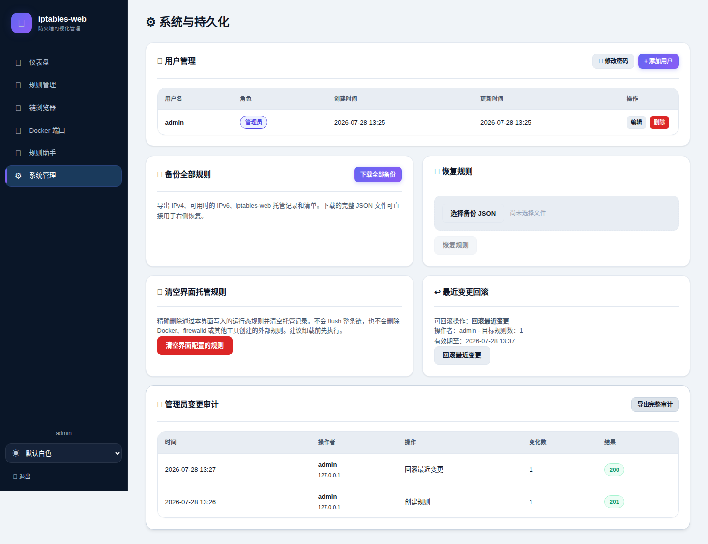

# iptables-web

面向 Linux 主机和 Docker 发布端口的轻量级 Web 防火墙管理器。

iptables-web 把容易出错的 `iptables` 操作变成可预览、可验证、可审计、可回滚的管理流程。它只管理自己创建的 packet 规则，不接管 firewalld，也不会把普通监听端口误判成 Docker 映射。

> [!WARNING]
> 当前版本默认使用 HTTP，并会在首次启动时创建 `admin/admin123`。程序尚未强制首次登录改密。请仅在可信管理网络中部署，登录后立即修改密码；不要直接暴露到公网。

## 目录

- [为什么需要它](#为什么需要它)
- [界面预览](#界面预览)
- [核心功能与实现](#核心功能与实现)
- [工作原理](#工作原理)
- [支持范围](#支持范围)
- [快速开始](#快速开始)
- [常用操作](#常用操作)
- [配置](#配置)
- [项目状态](#项目状态)
- [开发与测试](#开发与测试)
- [仓库与发布约定](#仓库与发布约定)
- [文档](#文档)
- [许可证](#许可证)

## 为什么需要它

直接维护宿主机和 Docker 防火墙通常会遇到以下问题：

| 问题 | iptables-web 的处理方式 |
| --- | --- |
| 规则参数和执行顺序容易写错 | 表单校验规则作用域，保存前显示字段差异；具体链支持拖动排序 |
| Docker DNAT 后端口已经变化 | 使用 conntrack 的原始目标 IP/端口匹配发布前的宿主机地址 |
| 看见监听端口，却无法确认是否由 Docker 发布 | 只信任 Docker socket 或 Docker CLI 返回的映射 |
| `DOCKER-USER` 链存在，但流量不一定经过它 | 保存 Docker 策略前检查真实的 `FORWARD → DOCKER-USER` 路径 |
| 修改防火墙后难以追责或撤销 | 记录操作者、来源、请求结果和前后差异；保留最近一次规则变更的限时回滚快照 |
| 应用卸载时容易误删其他工具的规则 | 规则带应用所有权标识，只精确删除本程序托管的规则 |
| firewalld、iptables 和 nftables 的职责容易混淆 | Web 管理只写入 iptables/iptables-nft；firewalld 和原生 nftables 仅由外部工具管理 |

## 界面预览

### 仪表盘


### Docker 访问策略


### 管理员审计与限时回滚



截图来自 `DEV_MODE=true` 的开发环境，不会修改主机防火墙。

## 核心功能与实现

### 规则管理

**解决的问题**

手写规则时，链、动作、端口、连接状态和插入位置相互影响。一个过宽的 DROP 或错误的规则顺序可能直接中断 SSH、管理端口或业务流量。

**实现方式**

- 前端在创建和编辑时生成字段级变更预览，用户再次确认后才调用写接口。
- 后端使用严格 JSON 解码和模型校验，拒绝未知字段、IPv6 地址误入 IPv4 后端，以及普通 `dport` 与 Docker 原始目标端口的冲突组合。
- 所有规则变更串行执行，防止并发请求交叉覆盖。
- 执行层使用所有权 comment、xtables 锁等待和命令超时，写入后再次核验运行态规则。
- `rules.json` 采用原子写入；执行或持久化失败时恢复变更前状态。

支持的操作包括新增、编辑、启停、删除和同链排序。当前管理链为：

```text
INPUT
FORWARD
OUTPUT
DOCKER
DOCKER_USER
```

### Docker 发布端口策略

**解决的问题**

Docker 的 `-p 18080:80` 会先把宿主机 `18080` DNAT 到容器 `80`。流量到达 `DOCKER-USER` 时，普通 `--dport` 看到的可能已经是容器端口，直接匹配 `18080` 不会生效。

**实现方式**

- 通过 Docker socket/CLI 获取经过 Docker 确认的发布映射。
- 用“协议 + 原始宿主机 IP + 原始宿主机端口”关联映射与托管规则。
- 生成 `--ctorigdst`、`--ctorigdstport` 和 `--ctdir ORIGINAL` 条件，匹配 DNAT 前的访问目标。
- 创建白名单时整体保存“允许来源 ACCEPT + 兜底 DROP/REJECT”，并检查 ACCEPT 必须位于兜底规则之前。
- 显示停用规则、残留策略、实际位置和链路诊断；链路不可用时拒绝创建看似成功但不会命中的规则。

### 变更审计与回滚

**解决的问题**

普通访问日志只能说明某个接口被调用，不能回答“谁修改了哪条规则、修改前后是什么、是否成功”，也无法快速撤销误操作。

**实现方式**

- 变更中间件在写请求前后分别获取规则和用户快照并计算差异。
- 审计事件包含请求 ID、操作者、角色、来源地址、操作类型、HTTP 状态和字段前后值。
- 事件追加写入权限为 `0600` 的 JSONL 文件，系统管理页可查看最近记录并导出完整 JSON。
- 成功修改规则后，将变更前的托管规则保存为独立回滚快照。
- 回滚窗口默认 10 分钟；提交时必须携带当前快照 ID，避免页面过期后回滚了错误目标。
- 回滚会精确删除当前托管规则、恢复快照、重新同步并核验；任一步骤失败都会尝试恢复回滚前状态。

审计覆盖应用内的规则、Docker 白名单、恢复、清理、回滚、用户和密码写操作。它不是操作系统级审计，也尚未提供日志签名、远程汇聚或自动轮转。

### 备份与恢复

**解决的问题**

只导出 `iptables-save` 无法保留应用托管关系；只备份 `rules.json` 又无法还原完整运行态规则。

**实现方式**

完整备份是带版本清单的组合 JSON，包含：

- `packet.rules`：完整 packet 规则集；
- 可用时的 IPv6 导出内容；
- `managed-rules.json`：程序托管记录；
- `manifest`：格式版本、后端和文件说明。

恢复前会校验清单并准备回滚状态。完整规则集恢复仍是高风险操作，生产环境必须保留带外控制台。

### 身份认证和权限

- 默认启用登录、验证码和服务端会话校验。
- 管理员可以修改规则、用户、备份、恢复、审计和回滚。
- 普通用户只能访问允许的只读功能和修改自己的密码。
- 用户、审计和回滚文件均以受限权限保存。
- 用户删除或修改密码后，相关旧会话会被撤销。

当前会话 Token 存储在浏览器 `sessionStorage`，传输层由部署方提供 HTTPS 反向代理；安全 Cookie 会话尚未实现。

### 规则助手

规则助手可生成或解释 iptables、ip6tables、nftables 和 firewalld 命令。生成结果只用于人工审核，不会自动执行。

这与运行后端是两个概念：

- 管理界面的写操作只使用 iptables 或 iptables-nft 兼容层；
- 原生 nftables 写入后端已禁用；
- firewalld Zone 和 rich rule 始终由程序外部管理。

## 工作原理

```text
浏览器
  │  登录、预览、确认
  ▼
Go HTTP API
  ├─ 认证与角色校验
  ├─ 严格解码与规则校验
  ├─ 变更串行化
  └─ 审计前后快照
        │
        ├──────────────► audit.jsonl
        ├──────────────► rollback.json
        ▼
规则存储 rules.json
        │
        ▼
iptables 执行器
  ├─ iptables / iptables-nft
  ├─ xtables 锁等待与超时
  └─ 写入后 VerifyRules
        │
        ▼
Linux packet filter
```

`web/` 是前端源码，构建前同步到 `assets/web/`，再由 Go `embed` 编入单个服务端二进制。

## 支持范围

| 能力 | 状态 | 说明 |
| --- | --- | --- |
| Linux IPv4 packet 规则 CRUD | ✅ | iptables、iptables-nft、iptables-legacy |
| Docker bridge/NAT IPv4 发布端口 | ✅ | 推荐使用 `DOCKER_USER` |
| Docker 映射发现和链路诊断 | ✅ | Docker socket 优先，CLI 作为回退 |
| 规则预览、审计导出、限时回滚 | ✅ | 应用内管理员写操作 |
| IPv4/IPv6 规则集备份 | ✅ | IPv6 可导出，但不能通过界面托管 |
| IPv6 托管规则 CRUD 和排序 | ❌ | Docker IPv6 映射当前只读 |
| 原生 nftables 写入 | ❌ | 为避免错误扩大作用范围，明确拒绝启动 |
| firewalld Zone/rich rule 管理 | ❌ | 保持为独立管理面 |
| Docker host、macvlan、ipvlan、Swarm、rootless | 未验证 | 首次使用必须检查真实计数器和流量路径 |
| 首次登录强制改密 | ❌ | 当前必须人工立即修改 |
| 内建 HTTPS / 安全 Cookie 会话 | ❌ | 建议置于可信网络中的 HTTPS 反向代理后 |

## 快速开始

### 系统要求

- Linux；
- root 权限或等效的 `NET_ADMIN` / `NET_RAW` 能力；
- 可用的 iptables、iptables-nft 或 iptables-legacy；
- 管理 Docker 发布端口时需要 Docker socket 或 Docker CLI。

### 使用发布包

二进制压缩包应从 [GitHub Releases](https://github.com/anhaot/iptables-web/releases) 下载，不保存在源码分支中。

```bash
sha256sum -c iptables-web-<版本>-linux-amd64.tar.gz.sha256
tar -xzf iptables-web-<版本>-linux-amd64.tar.gz
cd iptables-web-<版本>-linux-amd64
sudo bash install-binary.sh
```

默认访问地址：

```text
http://服务器IP:33801
```

默认账号：

```text
admin / admin123
```

登录后请立即修改密码，并在 firewalld、云安全组或上游 ACL 中把管理端口限制到可信来源。

### 从源码安装

需要 Go 1.26.5：

```bash
git clone https://github.com/anhaot/iptables-web.git
cd iptables-web
sudo bash scripts/install.sh
```

### Docker Compose

```bash
docker compose up -d --build
```

容器使用 host network，并需要 `NET_ADMIN`、`NET_RAW`。挂载 Docker socket 可以获得准确的发布端口信息：

```yaml
volumes:
  - /var/run/docker.sock:/var/run/docker.sock:ro
```

## 常用操作

### 选择正确的链

| 流量 | 推荐链 |
| --- | --- |
| 宿主机进程监听的 SSH、Web、数据库端口 | `INPUT` |
| Docker bridge/NAT 发布端口 | `DOCKER_USER` |
| 明确需要处理转发流量 | `FORWARD` |
| 宿主机主动发出的流量 | `OUTPUT` |

白名单必须先 ACCEPT 指定来源，再 DROP 或 REJECT 其他来源。不要在没有带外控制台的情况下创建宽范围拒绝规则。

### firewalld 分工

iptables-web 不会读取、编辑、reload 或删除 firewalld 配置。建议：

- firewalld：管理 SSH、Cockpit、iptables-web 管理端口等宿主机服务；
- iptables-web：管理 Docker 发布端口和明确选择的 packet 链。

### 卸载

```bash
sudo bash uninstall.sh
```

默认卸载会精确删除本程序托管规则，再删除服务、二进制和数据；不会 flush 整条链，也不会修改 firewalld。保留数据或规则等选项参见[部署手册](docs/deployment.md)。

## 配置

| 环境变量 | 默认值 | 说明 |
| --- | --- | --- |
| `LISTEN_ADDR` | `0.0.0.0:33801` | HTTP 监听地址 |
| `RULES_FILE` | `/data/rules.json` | 托管规则存储 |
| `USERS_FILE` | 与规则文件同目录的 `users.json` | 用户与会话存储 |
| `AUDIT_FILE` | 与规则文件同目录的 `audit.jsonl` | 管理员变更审计 |
| `ROLLBACK_FILE` | 与规则文件同目录的 `rollback.json` | 最近规则变更快照 |
| `LOG_LEVEL` | `info` | 日志级别 |
| `AUTH_ENABLED` | `true` | 是否要求认证 |
| `API_KEY` | 空 | 脚本调用使用的可选 API Key |
| `FIREWALL_BACKEND` | `auto` | `auto`、`iptables`、`iptables-nft`、`iptables-legacy`、`dev` |

`nft` 和 `nftables` 不是受支持的运行后端，显式配置时服务会拒绝启动。

## 项目状态

### 已完成

- IPv4 托管规则 CRUD、启停、排序、持久化和运行态核验；
- Docker IPv4 映射发现、策略汇总、白名单整体保存和残留策略提示；
- 保存前字段差异预览；
- 管理员变更审计、完整导出和 10 分钟双确认回滚；
- IPv4/IPv6 组合备份与恢复；
- 用户、角色、验证码和会话撤销；
- 安装、升级、卸载和离线发布包校验。

### 本轮解决的问题

| 优先级 | 原问题 | 原因 | 解决方式 |
| --- | --- | --- | --- |
| P0 | 手工新增/编辑规则返回 400 | 前端仍提交已删除的 `zone` 字段，后端严格 JSON 解码拒绝未知字段 | 从规则初始化和提交对象中移除 `zone`，增加前端逻辑及真实浏览器创建回归 |
| P0 | 标准 Go 构建无法选择明确工具链 | `go.mod` 只声明模糊的 `go 1.26`，构建环境尝试寻找不匹配的精确工具链 | 声明 `go 1.26.0` 和 `toolchain go1.26.5`，与 Docker builder 统一 |
| P2 | 登录页宣称支持原生 nftables 双后端 | 文案落后于后端禁用原生 nftables 的安全决策 | 改为“iptables 与 iptables-nft 兼容后端” |
| P2 | `/favicon.ico` 返回 401 | favicon 未配置为公开静态资源 | 新增 SVG favicon、公开路径并提供 `.ico` 重定向 |
| P2 | 修改前无差异、成功后无完整审计与快速撤销 | 只有普通请求日志和失败时的内部回滚 | 增加字段预览、前后快照差异、JSONL 审计导出和限时回滚 |

### 尚未完成

| 优先级 | 项目 | 完成标准 |
| --- | --- | --- |
| P1 | 真实网络命名空间集成测试 | 覆盖 Docker 重启、xtables 锁竞争、INPUT/FORWARD/DOCKER-USER 和恢复失败 |
| P1 | IPv6 托管规则 CRUD 与排序 | 模型明确地址族，所有写入、核验、排序和浏览器流程支持 ip6tables |
| P1 | 首次登录强制改密 | 初始化一次性凭据，改密前禁止其他管理写操作 |
| P1 | HTTPS 与安全 Cookie 会话 | 提供 TLS 部署方案，迁移到 `HttpOnly + Secure + SameSite` Cookie |
| P2 | 审计长期存储增强 | 日志轮转、远程汇聚、签名或防篡改 |

更详细的计划见[路线图](docs/roadmap.md)。

## 开发与测试

```bash
go test ./...
go test -race ./...
go vet ./...
node scripts/ui-logic-test.js
bash -n scripts/*.sh
```

构建发布包：

```bash
VERSION=<版本号> bash scripts/build-package.sh
bash scripts/verify-package.sh dist/iptables-web-<版本号>-linux-amd64.tar.gz
```

`verify-package.sh` 校验压缩包、SHA-256、二进制版本和嵌入前端，不启动服务，也不操作本机防火墙。

本轮验证包括：

- Go 单元测试、race detector、vet 和服务端构建；
- 前端规则预览、Docker 策略、审计和回滚逻辑测试；
- Playwright 登录、favicon、规则预览与创建、审计导出、双确认回滚；
- 回滚后规则状态检查以及浏览器控制台错误检查。

## 仓库与发布约定

源码仓库只提交可审查、可复现的内容：

| 提交到 Git | 不提交到 Git |
| --- | --- |
| Go、HTML、CSS、JavaScript 源码 | `bin/`、`dist/` 和本地编译二进制 |
| 单元测试和测试脚本 | Playwright 输出、覆盖率文件和临时日志 |
| README、用户文档和文档截图 | 本地安全扫描/审查报告 |
| Dockerfile、Compose、安装脚本 | `.env`、编辑器配置和机器专用 Compose override |
| 示例配置和公开资源 | `rules.json`、`users.json`、审计日志、回滚快照等运行数据 |

发布压缩包和校验和上传到 GitHub Releases，不提交到 `main`。这样可以避免二进制膨胀 Git 历史，也能让 Release、Tag、源码和校验和一一对应。

`web/` 与 `assets/web/` 都需要提交：前者是可直接调试的前端源码，后者是 Go `embed` 使用的同步副本。提交前应确认两者一致：

```bash
diff -qr web assets/web
```

## 文档

- [文档导航](docs/index.md)
- [部署手册](docs/deployment.md)
- [配置说明](docs/configuration.md)
- [API](docs/api.md)
- [运维与排障](docs/operations.md)
- [架构](docs/architecture.md)
- [开发指南](docs/development.md)
- [安全说明](docs/security.md)
- [路线图](docs/roadmap.md)
- [贡献指南](CONTRIBUTING.md)

欢迎提交 Issue 和 Pull Request。提交代码前请先阅读[贡献指南](CONTRIBUTING.md)并运行完整测试。

## 许可证

本项目采用 [MIT License](LICENSE)。你可以使用、修改和分发代码，但必须保留原始版权和许可证声明；软件按现状提供，不附带任何担保。
